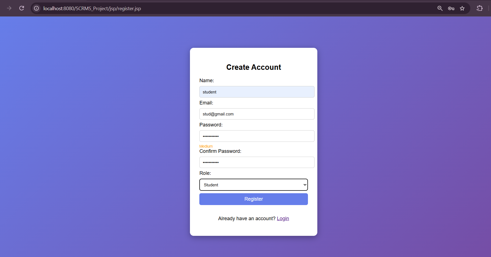
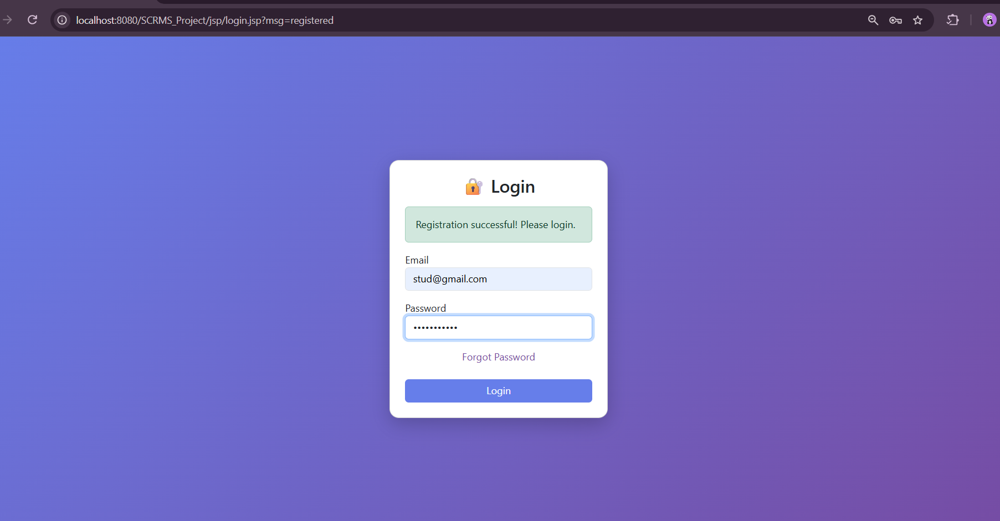
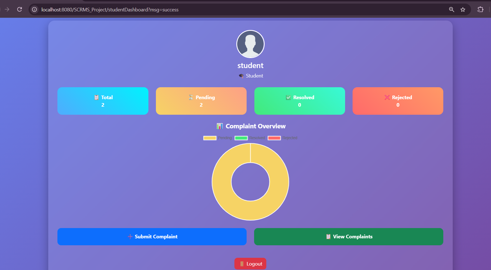
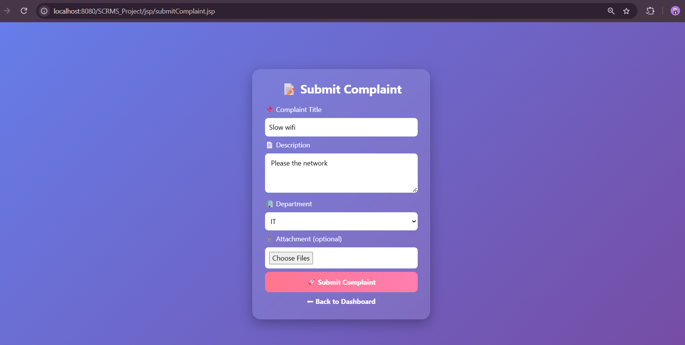
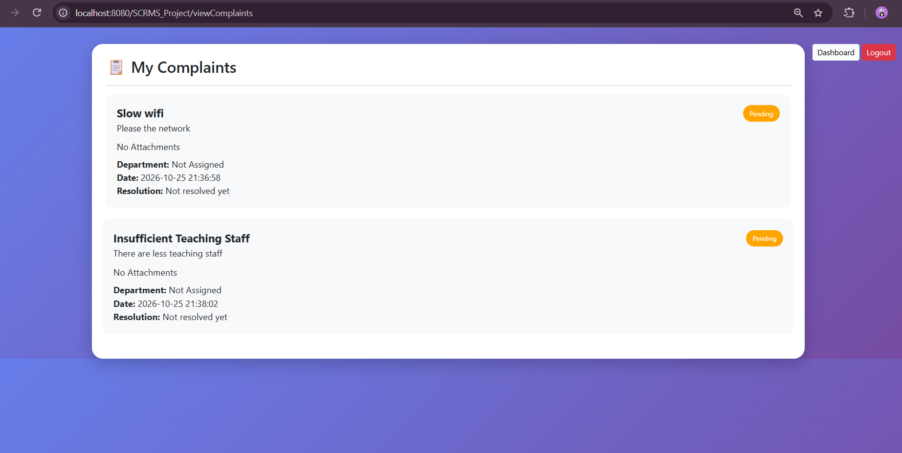
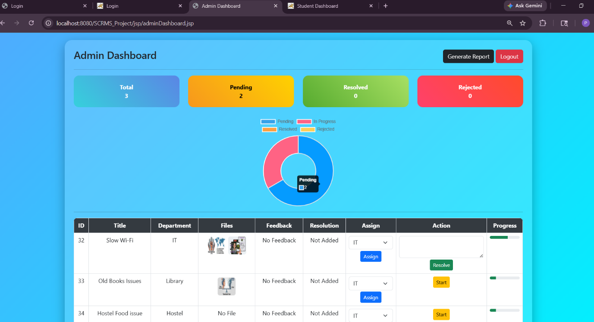
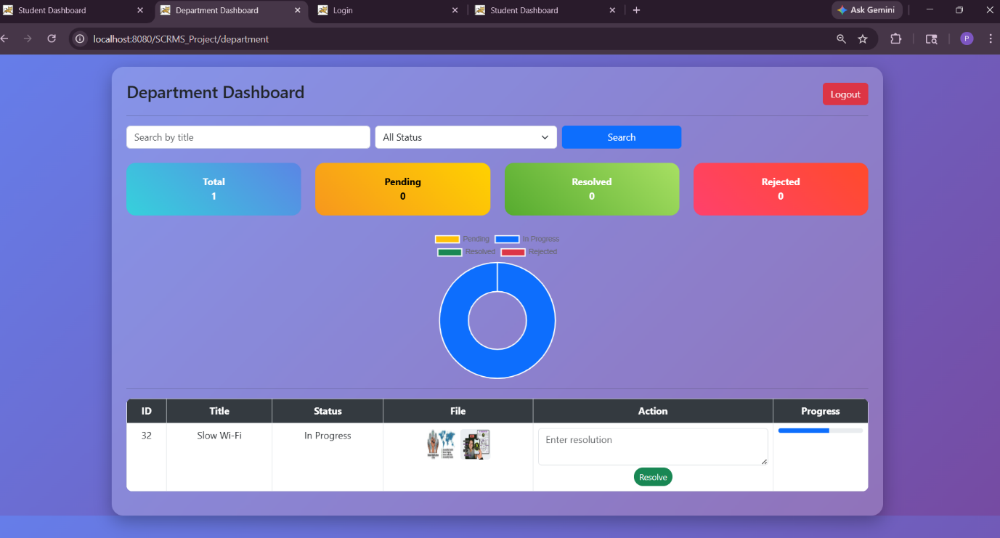
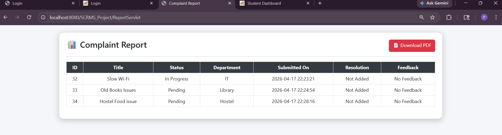

# 🎓 Student Complaint and Resolution Management System (SCRMS)

A web-based application designed to simplify the process of submitting, managing, tracking, and resolving student complaints within an educational institution.

SCRMS provides separate interfaces for students, department staff, and administrators to make complaint handling more organized, transparent, and efficient.

## 📌 Table of Contents

- [About the Project](#-about-the-project)
- [Features](#-features)
- [User Roles](#-user-roles)
- [Technology Stack](#-technology-stack)
- [Project Structure](#-project-structure)
- [Prerequisites](#-prerequisites)
- [Installation and Setup](#-installation-and-setup)
- [Database Configuration](#-database-configuration)
- [Screenshots](#-screenshots)
- [Future Improvements](#-future-improvements)
- [Author](#-author)

## 📖 About the Project

Handling student complaints manually can make it difficult to track requests, communicate updates, and maintain organized records.

The Student Complaint and Resolution Management System provides a centralized platform where students can submit complaints and monitor their progress. Department staff can review and process complaints, while administrators can oversee the complaint-resolution workflow.

The project was developed as an academic application to practice Java web development, database connectivity, and role-based application workflows.

## ✨ Features

- **User Authentication:** Registration and login functionality.
- **Role-Based Access:** Separate access for students, department staff, and administrators.
- **Complaint Submission:** Submit complaints with relevant details.
- **Complaint Tracking:** View complaints and their current status.
- **Department Processing:** Review and manage complaints assigned to a department.
- **Status Management:** Update complaint statuses and resolution details.
- **File Attachments:** Support for complaint-related attachments, subject to the application's configuration.
- **Feedback:** Allow students to provide feedback on complaint handling.
- **Dashboard:** Present complaint information and relevant statistics.
- **Reports:** Generate complaint reports, including PDF output if configured.
- **Password Recovery:** Provide a password-reset workflow.

## 👥 User Roles

### 🎓 Student
- Register and log in.
- Submit complaints.
- View submitted complaints.
- Track complaint status.
- Review resolution details.
- Submit feedback where available.

### 🏢 Department
- View complaints assigned to the department.
- Review complaint details.
- Process complaints and update their status.
- Add resolution information.

### 🛡️ Administrator
- Access the administrative dashboard.
- Oversee complaint records and their progress.
- Manage complaint processing and status updates.
- Review feedback and reports where available.

## 🛠️ Technology Stack

| Technology | Purpose |
|---|---|
| Java | Application logic |
| Java Servlets | Request handling and application control |
| JSP | Dynamic web pages |
| JDBC | Database connectivity |
| MySQL | Relational database |
| HTML5 | Web page structure |
| CSS3 | Styling and layout |
| JavaScript | Client-side interactions |
| Chart.js | Dashboard charts |
| Apache Tomcat 9 | Servlet/JSP application server |
| Eclipse IDE | Development environment |
| iText | PDF generation |

## 📂 Project Structure

The exact structure may vary depending on the Eclipse Dynamic Web Project configuration.

```text
SCRMS_Project/
├── src/
│   └── main/
│       └── java/
│           ├── controller/
│           ├── dao/
│           ├── model/
│           └── util/
│		└── webapp/
│ 	    ├── jsp/
│ 	    ├── META-INF/
│ 	    └── WEB-INF/   
│
├── database/
│   └── scrms_schema.sql
├── screenshots/
├── .gitignore
└── README.md
```

## ⚙️ Prerequisites

Before running the application, install or configure:

- Java Development Kit (JDK) compatible with the project.
- Eclipse IDE for Enterprise Java and Web Developers, or an equivalent Eclipse installation with web tools.
- Apache Tomcat 9, if required by the project configuration.
- MySQL Server.
- MySQL Connector/J.
- Required project libraries.

## 🚀 Installation and Setup

### 1. Clone the Repository

```bash
git clone https://github.com/Ppalak03/Student-Complaint-Resolution-Management-System.git
```


### 2. Import the Project into Eclipse

1. Open Eclipse IDE.
2. Select **File → Import**.
3. Choose **General → Existing Projects into Workspace**.
4. Select the cloned project directory.
5. Finish the import.

If your project uses a different import format, follow the format appropriate to its existing Eclipse configuration.

### 3. Create the Database

1. Start MySQL Server.
2. Open MySQL Workbench or another MySQL client.
3. Create a database using the name expected by the application.
4. Import the SQL script from the `database/` directory.

For example, if the application expects a database named `scrms`:

```sql
CREATE DATABASE scrms;
```

Use the actual database name and schema required by the project.

### 4. Configure Database Connectivity

Update the database connection configuration to match your local environment.

Typical configuration values include:

- Database host
- Database port
- Database name
- MySQL username
- MySQL password

### 5. Configure Apache Tomcat

1. Add the compatible Tomcat server to Eclipse.
2. Associate the project with the server.
3. Check the project's web deployment configuration.
4. Resolve any missing library or server-runtime errors.

### 6. Run the Application

1. Right-click the project.
2. Select **Run As → Run on Server**.
3. Choose your configured Tomcat server.
4. Open the local application URL provided by Eclipse.

The exact URL and starting page depend on your project configuration.

## 🗄️ Database Configuration

The application uses MySQL to store application data.

The database setup script should be placed in:

```text
database/scrms_schema.sql
```

## 🖼️ Screenshots

The following screenshots demonstrate the main interfaces of the Student Complaint and Resolution Management System.

### Register Page


### Login Page


### Student Dashboard


### Submit Complaint


### View Complaint


### Admin Dashboard


### Department Dashboard


### Complaint Reports

## 🔮 Future Improvements

Possible future enhancements include:

- Email notifications for complaint-status updates.
- Improved complaint search and filtering.
- More detailed analytics and reporting.
- Stronger authentication and account recovery.
- Improved mobile responsiveness and accessibility.
- More comprehensive audit logs and complaint-history tracking.

## 👩‍💻 Author

**Palak Prajapati**

MCA Student | Aspiring Java Developer

- GitHub: [@Ppalak03](https://github.com/Ppalak03)
- LinkedIn: [Palak Prajapati](https://www.linkedin.com/in/palak-prajapati-a63561329/)

---

⭐ If you find this project useful, feel free to explore the repository and learn from its implementation.
